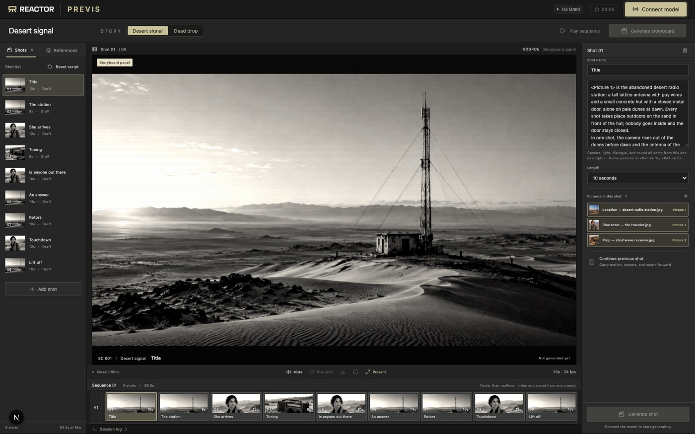

# storyboard-previs

A previs tool on top of `reactor/fast-h3-omni`. You write a scene as a list of
shots, each with a prompt, a length, and the reference pictures it uses. The
app uploads the pictures once, queues all the shots, and the model plays them
back-to-back as a live stream while the later ones are still rendering. When
the sequence ends you can type what happens next and it continues from the
last frame.



Two scripts ship with it: *Desert signal* (nine shots, sci-fi) and *Dead
drop* (six shots, a thriller in a library). The reference pictures are
generated and fictional. The prompts used to make them are in
`public/references/prompts.json` and `drop-prompts.json`.

## Running it

You need Node 20.9+, a browser with WebRTC, and a Reactor API key
(dashboard → API Keys).

```bash
cd examples/storyboard-previs
cp .env.example .env.local   # put your key in it
npm install
npm run dev
```

Open http://localhost:3000. Not `127.0.0.1`: the Next dev server won't serve
its client bundle to a different origin and you'll get an empty page.

Click **Connect model**, wait for "pictures ready" in the bar under the
monitor, then **Generate storyboard**. After the sequence ends the prompt bar
appears over the held frame. **Continue** starts the next clip from that
frame; **Cut** makes a new shot in the same scene. **Play sequence** replays
the recording, which works without the model connected. **Present** goes
fullscreen.

Beats you add live show up under "Added live" in the shot list and are not
part of the timeline. **Clear added** removes them, **Reset script** puts a
story back to its original shots.

### Environment

`.env.local` is read by the two route handlers in `app/api/` and nothing else.

```
REACTOR_API_KEY     required. Swapped for a session JWT in app/api/token/route.ts.
                    The JWT allows one fast-h3-omni session; the key never reaches the browser.
ANTHROPIC_API_KEY   optional. Turns the beat you type into full shot direction
                    (app/api/direct/route.ts). Without it the beat is sent as typed.
DIRECTOR_MODEL      optional. Defaults to claude-haiku-5-5.
```

## How it works

Everything is in `app/page.tsx`; the pieces worth knowing about:

**Pictures.** `lib/reference-kit.ts` lists each story's pictures. On `ready`
the app shrinks each one to 768px, calls `uploadFile`, and caches the
`FileRef` for the session. A shot's `refs` array is the upload order, which is
the `<Picture N>` numbering in its prompt.

**Prompts.** `lib/storyboard.ts`. Each shot is built from shared binding lines
(`<Subject 1> is the courier in <Picture 1>, with ...`) so a character is
described the same way in every shot, then one `In one shot,` beat, then
`Camera:`, `Dialogue:`, `Soundscape:`, `Music:`. This is the format from the
model's prompt guide. Dialogue is one short line per clip. Every shot says
where it takes place, otherwise the model will happily move the action
indoors between cuts.

**The sequence.** `runSequence` sends `set_autoplay` and
`set_flush_on_clip_end: false`, then enqueues every shot. A shot marked
`connected` waits for its predecessor's `clip_generated` so it can pass
`continue_from_clip_id`. The model starts each clip when the previous one
ends and holds the last frame if the next isn't ready. The app listens for
`clip_started` / `clip_finished` to move the UI and the recorders along, and
reads `build_seconds` off `queue_update` for the "generated in" counter.

**Recording.** One `MediaRecorder` across the whole sequence plus one per
shot, all on a stream built from the `main_video` and `main_audio` tracks.
Takes go into IndexedDB. Replay uses two `<video>` elements so the next file
is loaded before the current one ends.

**Continuing.** `continueStory` takes the binding lines from the previous
shot, adds a sentence about what carries over, appends the new action, and
enqueues with `continue_mode: "frame"`. If the model refuses (for instance the
source clip aged out of the eight it keeps) it retries with `latent`. A refusal
arrives on the call that sent the command: `lib/command.ts` reads it there and
throws the model's reason. The
session log at the bottom shows every upload, enqueue, clip event, and the
assembled prompt.

## Layout

```
app/page.tsx                the studio
app/api/token/route.ts      API key -> session JWT
app/api/direct/route.ts     optional beat -> direction via Claude
components/generation-overlay.tsx
lib/storyboard.ts           the two scripts
lib/reference-kit.ts        pictures per story
lib/recordings.ts           IndexedDB for takes
lib/image.ts                shrink before upload
lib/command.ts              send a command, throw its refusal
public/references/          pictures + the prompts that made them
public/boards/PROMPTS.md    prompts for drawn panels, if you want them
```

## Changing things

Shots: edit `lib/storyboard.ts`. One beat per shot, pictures referenced by
position in `refs`, lengths from the model's allowed set (5.875, 8, 10.125,
12.25, 14.375), spoken lines short.

Cast: drop JPEGs in `public/references/`, add them to `referenceKit` with the
story id, reference them from shots. The existing image prompts show how much
wardrobe and face detail it takes to keep someone consistent.

Director: the system prompt in `app/api/direct/route.ts`.

## Problems

- Empty page: you're on `127.0.0.1`. Use `localhost`.
- No sound: the browser blocked autoplay. The app starts audio on your next
  click and says so in the log.
- Slow "uploading pictures": that's your uplink to the model's region. The
  log prints KB/s per picture.
- Continuation refused: the log has the model's reason. It falls back to
  latent on its own; if that fails too, use Cut.
- Title text garbled: video models are bad at text. The title shots are
  short; take another.
