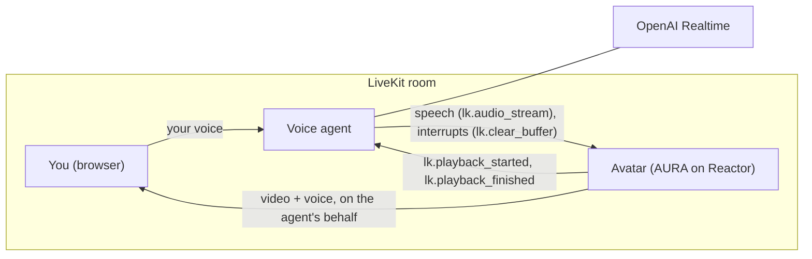

# Talking Avatar

Talk to a voice agent that has a face. A [LiveKit](https://livekit.io) voice agent holds the conversation on OpenAI
Realtime, and speaks through a talking avatar that [AURA](https://github.com/kyutai-labs/aura) renders, live, from one
portrait: 576x576 at 16 FPS, lip-synced to the agent's speech, on one NVIDIA B200 served by Reactor.

The avatar is a LiveKit avatar: it joins the call's room as a participant and speaks LiveKit's avatar protocol, so any
LiveKit voice agent can use it, and any avatar model that implements the same small contract can replace it. The
example ships a second model that does: [LiveAvatar](#the-alternative-model-liveavatar), for commercial use or 25 FPS.

AURA's code and weights are licensed for non-commercial use only; LiveAvatar's are Apache 2.0.

## What is in here

| Folder | What it is | Runs on |
| --- | --- | --- |
| [`aura-model/`](aura-model) | The avatar model: a `reactor` workspace that serves AURA as a LiveKit avatar | A B200 machine, with `reactor run`, or on Reactor |
| [`liveavatar-model/`](liveavatar-model) | The alternative avatar model, LiveAvatar, behind the same contract; see [below](#the-alternative-model-liveavatar) | A B200 machine, with `reactor run`, or on Reactor |
| [`voice-agent/`](voice-agent) | The voice agent: an OpenAI Realtime conversation, spoken through the avatar | Anywhere with Python 3.12 |
| [`client/`](client) | The page: pick a face and a voice, start a call, talk; its server routes start and stop each call | Anywhere with Node.js 20 |
| [`skill/`](skill) | A skill for a coding agent: sets the whole thing up with you, and explains how the model works | Your coding agent |

## How a call works



When you press **Start call**, the page's server routes ([`client/app/api/calls/route.ts`](client/app/api/calls/route.ts)):

1. create a LiveKit room and dispatch the voice agent into it;
2. mint the avatar's token: kind `agent`, publishing on behalf of the voice agent, so you see and hear one speaker;
3. start the model's session with the portrait as its starting input (`set_avatar`), upload the portrait, and ask the
   session to join the room with that token ([`client/lib/reactor.ts`](client/lib/reactor.ts));
4. hand your browser its own token, once the avatar is in the room.

There is no service in between: the page's server talks to the model directly, on a runtime you serve yourself or on
Reactor, and to LiveKit's server API. In the call, the agent hears you, answers through OpenAI Realtime, and streams its
speech to the avatar. The avatar renders a block of video per block of speech (1.0 s with AURA) and publishes it with
that speech, lip-synced. When you talk over it, the agent sends `lk.clear_buffer`; the avatar stops at once and reports how far it
got with `lk.playback_finished`, so the agent knows what you heard. Hanging up stops the session and deletes the room.

[`aura-model/README.md`](aura-model/README.md) explains how the model streams and keeps real time.

## What you need

- **For the model:** Linux with one NVIDIA B200 (the model holds about 36 GB), Docker with the NVIDIA Container
  Toolkit, the [Reactor CLI](https://docs.reactor.inc/deploy/platform/installation), and about 18 GB of disk for the
  weights. Or a deployment of the model on Reactor and a Reactor API key.
- **A LiveKit project** whose URL the model can reach: [LiveKit Cloud](https://cloud.livekit.io) works. You need its
  `wss://` URL, an API key and its secret.
- **An OpenAI API key** with access to the Realtime API.
- **For the agent and the page:** [uv](https://docs.astral.sh/uv/) (Python 3.12) and Node.js 20 or later.
- **A browser with a microphone**, on `http://localhost`: browsers allow the microphone only there or on HTTPS. On a
  remote machine, forward the page's port: `ssh -L 3000:127.0.0.1:3000 <host>`.

## Run it

### 1. The model

On the B200 machine, prepare the weights once, then serve the model:

```sh
cd aura-model
pip install "huggingface_hub[cli]<1"
python prepare_weights.py --output /path/to/aura-weights --allow-download
reactor build
reactor run --gpus device=0 --weights /path/to/aura-weights --port 8080
```

**Check:** `curl http://localhost:8080/health` reports `"state":"available"` (a few minutes the first time: loading
compiles the model and renders warm-up chunks). The model serves one call at a time. To run LiveAvatar instead, see
[the alternative model](#the-alternative-model-liveavatar); the next steps stay the same.

### 2. The voice agent

```sh
cd voice-agent
cp .env.example .env       # LIVEKIT_URL, LIVEKIT_API_KEY, LIVEKIT_API_SECRET, OPENAI_API_KEY, AVATAR_AGENT_NAME
uv run python agent.py dev
```

**Check:** the log says `registered worker {"agent_name": "<AVATAR_AGENT_NAME>", ...}`. The name makes the worker join
only the rooms your page dispatches it into, even on a LiveKit project others use.

### 3. The page

```sh
cd client
npm install
cp .env.example .env.local # the same LiveKit values and AVATAR_AGENT_NAME, and where the model is
npm run dev                # http://127.0.0.1:3000
```

Point the page at the model with `REACTOR_RUNTIME_URL=http://127.0.0.1:8080` for the runtime from step 1 (use the
machine's address if the page runs elsewhere), or with `REACTOR_API_KEY` and `REACTOR_MODEL` for a model deployed on
Reactor. **Check:** `curl -s http://127.0.0.1:3000/api/status` names the model, the LiveKit host and the agent, and the
page's status says Ready.

### 4. Talk

Open `http://localhost:3000`, pick a face (four ship in [`client/assets/`](client/assets); **+** uploads your own: one
face, frontal, well lit), pick a voice, optionally tell the agent who it is, and press **Start call**. The avatar
greets you a few seconds later. Interrupt it by talking over it; **End call** hangs up. The room panel lights up as each
participant joins and shows what flows between them.

## Configuration

| Where | Key | What it does |
| --- | --- | --- |
| `client/.env.local` | `LIVEKIT_URL`, `LIVEKIT_API_KEY`, `LIVEKIT_API_SECRET` | The LiveKit project the calls run on |
| `client/.env.local` | `AVATAR_AGENT_NAME` | The voice agent to dispatch into each call |
| `client/.env.local` | `REACTOR_RUNTIME_URL`, or `REACTOR_API_KEY` and `REACTOR_MODEL` | Where the avatar model runs |
| `voice-agent/.env` | `LIVEKIT_*`, `OPENAI_API_KEY`, `AVATAR_AGENT_NAME` | The agent's project, model and name |
| `voice-agent/.env` | `AVATAR_AGENT_VOICE` | The voice when a call names none |
| `aura-model/config.yml` | `prompt`, `audio_context_s`, `avatar`, `compile`, pacing | See the comments in the file |

Every secret stays on a server: the page's server holds the LiveKit secret and, for Reactor, the API key; the browser
only ever gets a room token.

## When it does not work

| Symptom | Fix |
| --- | --- |
| The page says "Setup incomplete" | `curl /api/status` shows what is missing in `client/.env.local`; restart `npm run dev` after editing it |
| "the voice agent ... did not join within 20 s" | The agent is not running, or `AVATAR_AGENT_NAME` differs between `client/.env.local` and `voice-agent/.env` |
| "the runtime refused the session: HTTP 409" | The model serves one call at a time: end the other call, or wait a few seconds after one ends |
| "the avatar could not join the room" | The model cannot reach `LIVEKIT_URL`, or the LiveKit key and secret do not belong to that project |
| The avatar appears but never speaks | The agent has no OpenAI Realtime session: read its log, check `OPENAI_API_KEY` |
| No microphone prompt | Open the page as `http://localhost:<port>`, with port forwarding on a remote machine |
| The avatar's picture freezes mid-call | The model failed during the call: its log says `the avatar model failed` and why. It stops that call's video and keeps serving; end the call and start another |

## The alternative model: LiveAvatar

[`liveavatar-model/`](liveavatar-model) serves [LiveAvatar](https://github.com/Alibaba-Quark/LiveAvatar) behind the
same contract, with the same application code. Use it when you need commercial use, or 25 FPS.

| | AURA (`aura-model/`, the default) | LiveAvatar (`liveavatar-model/`) |
| --- | --- | --- |
| Output | 576x576, 16 FPS | 512x512, 25 FPS |
| Model | [AURA-1.3B](https://huggingface.co/kyutai/AURA-1.3B), 1.3B parameters | [Live-Avatar](https://huggingface.co/Quark-Vision/Live-Avatar) on [Wan2.2-S2V-14B](https://huggingface.co/Wan-AI/Wan2.2-S2V-14B), 14B parameters |
| On one B200 | About 36 GB; a 1.0 s chunk in 0.61 s | Needs about 80 GB free; a 0.48 s block in 0.46 s, with `fp8` |
| Weights | About 18 GB | About 50 GB |
| License | Non-commercial (code: Snap Inc. Non-Commercial License; weights: CC BY-NC 4.0) | Apache 2.0 |

To run it, do step 1 in `liveavatar-model/` instead (its [README](liveavatar-model/README.md) has the commands and its
configuration). Steps 2 to 4 are unchanged: the agent and the page work with either model.

## Set it up with a coding agent

[`skill/SKILL.md`](skill/SKILL.md) walks a coding agent through all of the above with you, with AURA: it asks what you
have (a GPU or Reactor, a LiveKit project, an OpenAI key), fills in the env files without printing secrets, starts each
piece and checks it. It deploys LiveAvatar only when you ask for it. It also explains how the models stream and keep
the face in sync with the voice, from [`skill/how-it-works.md`](skill/how-it-works.md).
