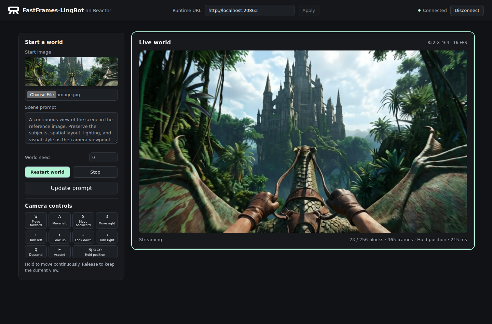

# FastFrames-LingBot on Reactor

Explore an uploaded scene with Apple's [FastFrames-LingBot 1.3B][native].
It generates 832 × 464 video from a starting image, a scene prompt, and live
camera input. After Start, frames stream continuously. Press a key to move
the camera. Release it to keep generating from the current pose.



## Run the model

Use Linux, Docker, the NVIDIA Container Toolkit, a CUDA 12.8-compatible
driver, the [Reactor CLI][cli], and one allocated NVIDIA B200. Allow about
20 GB for inference weights in addition to the container image. The Runtime
loads and warms the model before the first connection. The first build and
warmup can take several minutes.

```sh
reactor validate
reactor build
reactor run --gpus device=0 --port 8080 --shm-size 1g
```

Use `--weights /path/to/cache` to reuse the pinned downloads across restarts.
Check `http://localhost:8080/health` for the `available` state.

In another terminal, from the model directory, start the demo with
Node.js 22.12 or newer.

```sh
cd demo
npm ci
npm run dev -- --host 127.0.0.1
```

Open the URL printed by Vite. Apply the Runtime URL, click **Connect**, and
select a landscape JPEG, PNG, or WebP (up to 8 MiB). Use the prefilled scene
prompt or edit it, then click **Start world**. The upstream [jungle image][example]
and [prompt][prompt] are an example pair. For a remote Runtime behind SSH,
configure authenticated TURN/TCP and forward the relay TCP listener along
with the Runtime HTTP and frontend ports.

## Camera controls

| Keyboard | Action |
| --- | --- |
| W / S | Move forward / backward |
| A / D | Move left / right |
| ← / → | Turn left / right |
| ↑ / ↓ | Look up / down, with a stronger pitch per block |
| E / Q | Ascend / descend |
| Space | Hold the current camera pose |

The same actions are available as on-screen buttons. Tap to move for one
block or hold to keep moving. Releasing the key holds the camera pose as
generation continues. Switching tabs clears held and queued input.
The viewer who starts the world controls it. **Stop** clears the world and
**Disconnect** ends the session.

The scene prompt and seed come from the Start form. **Update prompt** queues
new text for the next block inside the same world. Already generated
frames retain their existing content.

Interactive playback is fixed at **16 FPS**, aligned with the native camera
timeline and reference video export. The first block contains 13 frames,
subsequent blocks contain 16, and a world finishes after 256 blocks
(4,093 frames, about 4 minutes 16 seconds). This uses all 1,024 latent
positions in the released model. Start a fresh world to keep exploring.

On one B200, the browser received the stream at 16 FPS through 23 blocks,
including held camera input and release. In a separate matched-input test,
the native pipeline and this adapter both drifted back toward the opening
view during a long hold.

| SDK command | Parameters |
| --- | --- |
| `start_world` | Uploaded `image` reference, `prompt`, optional `seed` |
| `move_camera` | `world_id`, native `action`, optional `hold` |
| `release_camera` | `world_id`, optional `discard_pending` |
| `update_prompt` | `world_id`, `prompt` |
| `stop_world` | `world_id` |

Subscribe to `state_update` for world progress and the `main_video` track
for video. The model step uses Apple's `KeyboardCamera`, `LiveCamera` and
`FastFramesLingBot`. Vertical arrows apply two native 3° pitch rotations per
latent frame. The build downloads the pinned Apple and
LingBot source trees. The first run downloads the 1.3B DiT, shared text and
image encoders, KV refiner and pixel decoder.

See the published [Apple model terms][weights] and
[LingBot-World terms][lingbot-license]. Port by [Rising0321][author].

[native]: https://github.com/apple-aiml-research/ml-fastframes/blob/6044a56f44bffec500d04f2c21be3c5066891431/docs/lingbot.md
[weights]: https://huggingface.co/apple/FastFrames-S
[example]: https://raw.githubusercontent.com/robbyant/lingbot-world-v2/1895d300d8ac936401689b26389f51cbd36530eb/examples/00/image.jpg
[prompt]: https://raw.githubusercontent.com/robbyant/lingbot-world-v2/1895d300d8ac936401689b26389f51cbd36530eb/examples/00/prompt.txt
[cli]: https://docs.reactor.inc/deploy/platform/installation
[lingbot-license]: https://github.com/robbyant/lingbot-world-v2/blob/1895d300d8ac936401689b26389f51cbd36530eb/LICENSE
[author]: https://github.com/Rising0321
