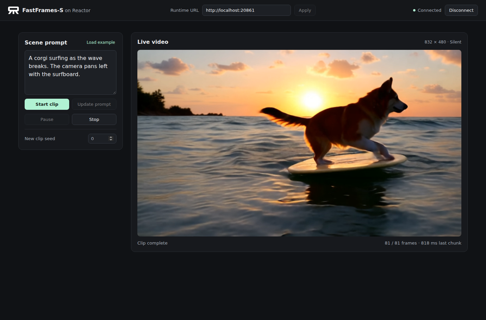

# FastFrames on Reactor

Stream Apple's [FastFrames-S][small] (1.3B) or [FastFrames-L][large] (14B) from a
text prompt. A single Reactor service loads one model variant. FastFrames-S is
the default. The local browser client receives 832 × 480 silent video and can
update the caption during generation.



Each clip uses the released 21-latent horizon. The first sample uses four
denoising steps and a clean cache write. Subsequent samples use two denoising
steps and Apple's learned KV refiner. The native pixel decoder emits one RGB
frame for the first latent, followed by four per latent, for 81 frames total.

## Run the model

Use Linux, Docker, the NVIDIA Container Toolkit, a CUDA 12.8-compatible driver
and the [Reactor CLI][cli]. The recipe targets one NVIDIA B200. Keep about 18 GB
of weight storage for S or 43 GB for L, plus space for the build image. Both
variants keep their model weights resident. Reactor streams both variants at
16 FPS, matching Apple's MP4 playback rate.

From this model directory:

```sh
reactor validate
reactor build
reactor run --gpus device=0 --port 8080 --shm-size 1g
```

Select an allocated GPU. The first run downloads the selected variant's pinned
inference weights, tokenizer and text encoder. Reuse them across restarts with
`--weights /path/to/fastframes-cache`. Check readiness and the client contract:

```sh
curl -fsS http://localhost:8080/health
curl -fsS http://localhost:8080/schema
```

Wait until the health state is `available` before connecting. To use **FastFrames-L**,
set `variant: ff-l` in `apple_fastframes.yaml`, rebuild and restart. Set it back
to `ff-s` for S. Both variants use the same client contract.

## Open the client

In a second terminal with Node.js 22.12 or newer:

```sh
cd demo
npm ci
npm run dev -- --host 127.0.0.1
```

Open the URL printed by Vite. Set **Runtime URL** if needed, click **Apply**,
then **Connect**. **Load example** inserts Apple's corgi prompt. Click **Start
clip** to generate. **Update prompt** changes text conditioning at the next
generated latent, while preserving the visual history, noise and decoder state.
Frames already buffered can still show the earlier caption. The native release
runs with a fixed caption, so live edits are an extension in this port. The
model's reaction can vary.

**Pause** holds generation at a chunk boundary and **Resume** continues it.
A prompt accepted while paused takes effect on resume. **Stop** clears the clip
and queued video while keeping weights resident. **Disconnect** explicitly ends
the session. A new connection starts with an empty clip. At 81 frames,
**Start clip** begins a fresh rollout.

| Control | SDK command |
| --- | --- |
| Start clip | `start` with `prompt` and optional `seed` (default 0) |
| Update prompt | `update_prompt` with the complete new `prompt` |
| Pause / Resume | `set_paused` with `paused: true` / `false` |
| Stop | `stop` |

The client reads `state_update` and the `main_video` track. For production
frontend files, run `npm run build` and serve `demo/dist` over HTTP. For a
remote Runtime reached through SSH, configure authenticated TURN/TCP and
forward its TCP listener along with Runtime HTTP and the frontend. Browser
HTTP connectivity alone does not establish media connectivity.

## Inference and validation

The worker calls Apple's denoising, scheduler, noise generation and KV
refinement directly. It uses the streaming pixel decoder from Apple's latency
code and applies the same leading-three-frame alignment as the native clip
decoder. One latent is processed per Runtime step. The native S and L configs
retain their own noise convention, transformer operations, TF32 policy and
decoder precision.

On one B200, median warm sampling and decode took **95 ms** for S and
**197 ms** for L per four-frame continuation chunk, including the RGB transfer
to CPU. These are model-side measurements. In the fixed-prompt corgi example
with seed 0, all 81 pre-transport RGB frames from each variant matched its own
native whole-clip reference exactly. Paired tests with two live caption
updates preserved the prefixes before each update and changed later frames.

The production browser client received all 81 frames from both variants at
the fixed rate over WebRTC. Warm clips had median frame intervals after
startup of 63 ms for S and 62 ms for L. The first clip after Runtime was ready
showed its first frame after 2.58 s for S and 2.78 s for L in the tested
TURN/TCP setup. Pause/resume, two in-clip caption changes, Stop and a fresh
session after Disconnect passed for both variants.

```sh
python -m pip install reactor-runtime==3.11.7 numpy PyYAML huggingface-hub pytest
python -m pytest -q
python -m reactor_runtime.schema --path . --version v0.1.0 --out /tmp/fastframes-schema.json
```

- `apple_fastframes.py` and `apple_fastframes_types.py` define the Runtime hooks
  and client contract.
- `apple_fastframes_model.py` owns model state and the plain CPU input/result.
- `apple_fastframes_backend.py` runs the native sampler and streaming decoder.
- `apple_fastframes_assets.py` pins the source and inference artifacts.

The pinned [Apple source][source] is fetched at build time under its own
license. The Apple checkpoints are provided under the Apple Machine Learning
Research Model License for non-commercial scientific research. See the
licenses on the [S][small] and [L][large] model pages. The S generator comes
from the Apache-2.0 [Causal Forcing++ release][cf]. Port by [Rising0321][author].

[small]: https://huggingface.co/apple/FastFrames-S
[large]: https://huggingface.co/apple/FastFrames-L
[source]: https://github.com/apple-aiml-research/ml-fastframes/tree/6044a56f44bffec500d04f2c21be3c5066891431
[cf]: https://huggingface.co/zhuhz22/Causal-Forcing
[author]: https://github.com/Rising0321
[cli]: https://docs.reactor.inc/deploy/platform/installation
