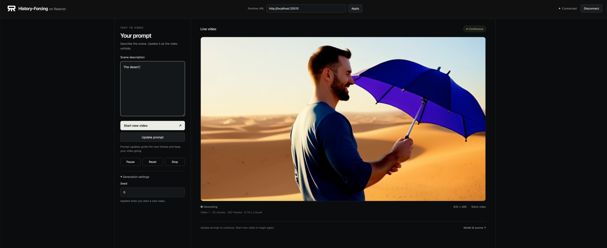

# History-Forcing on Reactor

Run [History-Forcing's DMD long-video model](https://github.com/ziplab/History-Forcing)
as a continuous text-to-video service with [Reactor](https://reactor.inc).
Describe a scene, press **Start video**, and update the prompt while it streams.
The browser client follows SGF+'s prompt-and-video layout.



The integration keeps the released **Wan2.1 1.3B, four-step BF16 EMA + MemRoPE**
inference path. Generation continues until Pause, Stop, or session end. Live
prompt changes preserve visual history and decoder state. Playback adapts to
measured generation speed.

## What you need

- Linux, Docker, an NVIDIA driver and the
  [NVIDIA Container Toolkit](https://docs.nvidia.com/datacenter/cloud-native/container-toolkit/latest/install-guide.html).
- One NVIDIA B200 for the tested recipe; other GPUs and offload configurations
  have not been validated. Weights remain resident on the GPU.
- About 28 GB for inference weights, plus Docker image and build-cache storage.
- Node.js 22.12+ and npm for the frontend.

## 1. Install the CLI

```sh
brew install reactor-team/tools/reactor-cli
# Alternatively:
curl -fsSL https://reactor.inc/install | bash
reactor version
```

See the [CLI installation guide](https://docs.reactor.inc/deploy/platform/installation).
Run backend commands from this directory.

## 2. Build and start the model

```sh
reactor validate
reactor build
reactor run --gpus device=0 --port 8080 --shm-size 4g
```

Select an available GPU. `device=0` selects host GPU 0; the isolated worker sees
it as device 0. First startup automatically downloads the pinned DMD checkpoint,
Wan backbone, text encoder, tokenizer and VAE. The native loader initializes the
backbone before loading the checkpoint's EMA weights. No training data or OPSD
world-model assets are downloaded.

Weights default to `~/.cache/reactor_registry/history-forcing`. To use another
volume, pass `--weights /path/to/history-forcing`. Subsequent starts reuse that
cache. A completely prepared cache needs no download or modification.

In another terminal, check readiness:

```sh
curl -s http://localhost:8080/health
curl -s http://localhost:8080/schema
```

Wait for `"state":"available"`. Loading time is separate from generation time.
Rebuild after code, dependency or manifest changes. `Ctrl+C` stops the service.
An inference failure ends the service because native caches may be partially
modified; restart the backend to recover.

## 3. Open the client

In another terminal, from this directory:

```sh
cd demo
npm ci
npm run dev -- --host 127.0.0.1 --port 5173
```

Open [http://localhost:5173](http://localhost:5173). Set **Runtime URL** in the center of the top bar to
`http://localhost:8080`, click **Apply**, then **Connect**. Enter a scene
in **Scene description** and press **Start video**. Connecting alone starts no generation.
The released DMD long-video launcher takes text. The separate OPSD / DreamX 5B
branch accepts an initial image, prompt and camera actions; it uses different
weights and is not served by this DMD client. This client does not offer image input.

Check that silent video appears at 832×480 and the chunk/frame counts increase.
To serve the production build instead:

```sh
npm run build
npm run preview -- --host 127.0.0.1 --port 5173
```

The Runtime URL can also be set with `?endpoint=http://localhost:8080`, or with
`VITE_REACTOR_ENDPOINT` when building the frontend. The demo connects to a local Runtime. A hosted deployment requires the platform's
model identity and backend token exchange; the demo includes no hosted endpoint.

### Remote GPU access

HTTP and WebRTC media must both reach the browser. SSH forwarding of port 8080
alone does not carry WebRTC UDP. For SSH-only access, configure an authenticated
TURN/TCP relay with Runtime's `TURN_SERVERS` setting and forward its TCP listener.
The relay address must be reachable by the Runtime container. Keep credentials
outside this repository.

For a GPU-host relay listening on TCP 3478, and a frontend also running there:

```sh
ssh -N -L 8080:127.0.0.1:8080 -L 5173:127.0.0.1:5173 \
  -L 3478:127.0.0.1:3478 your-gpu-host
```

Then open `http://localhost:5173/?endpoint=http://localhost:8080`. If the frontend
runs on your own computer, omit its 5173 forward. See the
[Runtime documentation](https://docs.reactor.inc/) for deployment and ICE settings.

## Controls

| Control | Effect |
| --- | --- |
| Start video / Start new video (`start`) | Start a fresh video with the entered prompt and seed; clear previous playback. |
| Update prompt (`set_prompt`) | Guide upcoming chunks while preserving the current video and its history. |
| Pause / Resume (`set_paused`) | Stop or resume computation between chunks; buffered frames may still play. |
| Reset (`reset`) | Restart with the accepted prompt and current seed. The SDK can supply a replacement seed. |
| Stop (`stop`) | Discard the current video and queued playback; keep the prompt for a new Start. |
| Disconnect | End the shared session and clear its model state. Connect starts a fresh session. |

The SDK-only `get_state` command reads a caller-only snapshot. The client uses it
after connection readiness so a viewer joining a paused session receives state.

**Seed** applies when starting a new video. Updating the prompt while paused
keeps the video paused. Text updates take effect at the next chunk boundary;
already generated frames retain their earlier conditioning. MemRoPE retains
visual history, so semantic changes can be gradual or incomplete. A prompt is
a scene description, not a timed script with guaranteed events.

The first chunk yields 9 frames; subsequent chunks yield 12. The native launcher
stops after 1005 video frames. This service can continue beyond that duration
while preserving video history, without periodically resetting the scene. There is no
configured duration limit, but arbitrary-duration visual quality is not guaranteed.

## Validation and limitations

On one B200, the official fixed-prompt run and incremental adapter matched exactly
across **84 chunks / 1005 frames**: maximum latent and raw uint8 RGB differences
were both zero before video encoding. This comparison used the README's guitar
prompt, seed 0 and the pinned dependency environment.

The browser streamed **370 consecutive chunks / 4437 frames** in one video,
crossing multiple noise pages and 1024 latent positions. That corresponds to
about **4.6 minutes at the native 16 FPS export rate**. Sampled GPU memory stayed
at **25,856 MiB (25.25 GiB)** from chunk 30 through 370.

Sampling plus streaming decode measured **17.11 FPS** after the first chunk.
The browser measured **16.94 decoded FPS** over a separate 30-second steady
interval with zero dropped frames; the first Runtime chunk arrived in **1.62 s**
after Start on an already loaded service. Download/model loading are excluded.
These measurements use one B200 and do not establish performance on a 4090.

CPU-only contract tests, schema/manifest validation, the canonical image build
and the production frontend build pass. The long browser rollout included two
prompt updates, pause/resume and a second viewer joining while paused. Production and Vite dev frontend
tests also cover refused commands, Reset, Stop→Start and Disconnect→fresh Connect.
All 27 CPU-only tests pass, including lifecycle and cache relocation checks.
A paired same-seed 30-chunk test confirms that both live prompt changes reach the
model: the first 10 chunks match the static control exactly; later conditioning
and output change while the same video continues.

The native script exports at 16 FPS; this is distinct from measured compute
throughput and adaptive browser playback. Live prompt changes and continuation
past the native finite rollout are integration extensions. Fixed-prompt parity
is tested separately from those features. This port uses the released DMD model;
the repository's OPSD DreamX world-model branch is outside this integration.

## Code and documentation

- `history_forcing.py` / `_types.py`: Runtime commands, session state and media.
- `history_forcing_model.py`: immutable worker inputs/results and model lifecycle.
- `history_forcing_backend.py`: incremental native sampling and causal decoding.
- `history_forcing_assets.py`: source and weight preparation before worker startup.
- `reactor.yaml`: reproducible image build and Runtime launch configuration.
- `demo/`: small React client using the official Reactor JavaScript SDK.

The worker uses upstream source pinned to
[`9d69c1e`](https://github.com/ziplab/History-Forcing/tree/9d69c1e5da2beb219e635f4400b8cb494759ba06).
It preserves native attention, MemRoPE compression, timesteps and VAE operations.
No native inference or training files are modified. Inspect `/schema` for the
command contract and see the [Reactor SDK documentation](https://docs.reactor.inc/)
for other clients.

## Credits and licensing

History-Forcing and its dependencies remain the work of their respective authors.
Reactor integration by [Rising0321](https://github.com/Rising0321). Feedback on the
integration and further collaboration are welcome at
[ruixing@reactor.inc](mailto:ruixing@reactor.inc).

The upstream root and vendored MemRoPE LICENSE files declare Apache-2.0, while
`dmd/long_video/third_party/memrope/attention.py` carries a
`SPDX-License-Identifier: CC-BY-NC-SA-4.0` header. The released DMD checkpoint card
does not specify a license. These upstream ambiguities need clarification before
redistribution or commercial use; this port does not relicense those materials.
