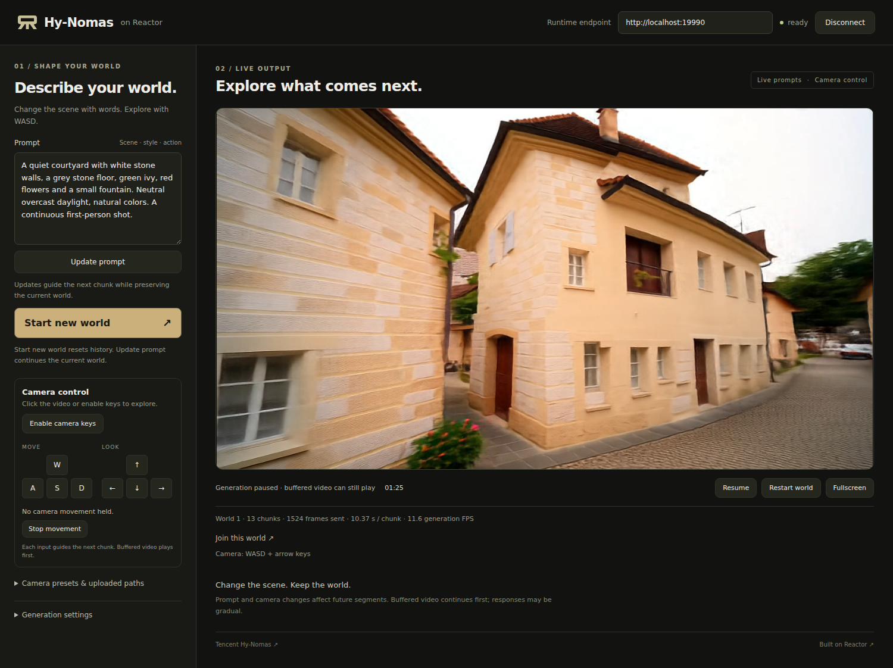

# Hy-Nomas on Reactor

Stream [Tencent Hy-Nomas](https://github.com/Tencent-Hunyuan/Hy-Nomas) through
[Reactor Runtime](https://github.com/reactor-team/reactor-runtime). Create a world
from text, update its prompt while retaining history, and explore with WASD and
arrow keys. Camera presets and calibrated trajectory uploads are also available.
The released inference path starts from text; image initialization is not exposed.



The integration reuses the released distilled checkpoint and native inference
pipeline. A small local demo provides explicit Connect and Start actions,
live prompt editing, combined keyboard/touch camera controls, pause/resume, and restart.

## What you need

- Linux, Docker, an NVIDIA driver and NVIDIA Container Toolkit.
- **Eight NVIDIA B200 GPUs** for the tested resident inference profile. Each worker
  loads the model; video tokens and attention history use sequence parallelism.
  The eight-GPU profile was validated over complete 120-second worlds with
  120-frame segments. Full history increases memory use and generation cost.
  This recipe targets Blackwell SM100. Other GPU architectures are not supported.
- At least 128 GB host RAM and about 80 GB for the inference checkpoints, plus
  space for the image and build cache. Allow at least 200 GB of free disk space.
- Node.js 22 and npm for the demo (tested with Node 22.23.4).
- The [Reactor CLI](https://docs.reactor.inc/deploy/platform/installation).
  This manifest uses `reactor/v2` and `reactor run --shm-size`.

## Build and start the model

Run from this directory:

```sh
reactor validate
reactor build
reactor run --gpus '"device=0,1,2,3,4,5,6,7"' --shm-size 8g --port 8080
```

The main, fast and resident quantized presets use eight workers. For another
supported count (1, 2, 4 or 8), match the selected config's `num_gpus`, the
manifest's `model.resources.gpu.count`, and the devices selected by `--gpus`.

The build installs Reactor Runtime 3.10.0, Python 3.13, CUDA 13.0.2,
PyTorch 2.10, and the released [MagiAttention 1.1.0 FA4 backend](https://github.com/SandAI-org/MagiAttention/releases/tag/v1.1.0)
for DiT and PixelUMM video attention. FlashAttention 2 remains an upstream import
dependency. The FA4 fork and Magi sources are pinned by revision. Kernel builds
and first-use compilation can take several minutes. Rebuild after changing adapter code or configuration.
Magi's optional communication extension is omitted; sequence parallelism uses
Hy-Nomas' native NCCL implementation.
The manifest checks out native source revision
`01b7dba36b05cf532dd8985e379aecc8b80d395f`; the model repository is not copied
into the adapter.

Startup automatically downloads the selected official distilled DiT, PixelUMM
decoder, and Qwen2.5-VL-7B text encoder into the persistent CLI weights directory.
It reuses completed downloads on later starts. Completed checkpoint directories
can be mounted read-only. Compiler caches use `TORCHINDUCTOR_CACHE_DIR` and
`TORCH_EXTENSIONS_DIR`, defaulting under `$XDG_CACHE_HOME/hy-nomas` or
`~/.cache/hy-nomas`; use writable persistent paths to retain compiled kernels
across container restarts. No training or teacher weights
are needed. Model and text revisions are pinned in `hy_nomas_assets.py`.
To reuse an existing cache, pass `--weights /your/persistent/hy-nomas` containing
`model/DiT/`, `model/VAE/`, and `text_encoder/` in the same layout.

Wait for model loading to finish, then check readiness in another terminal:

```sh
curl -fsS http://localhost:8080/health
curl -fsS http://localhost:8080/schema
```

Startup prepares two 120-frame segments and discards that temporary world before
readiness. Weights, working history and decoder state stay on GPU in the default
profile. The health state should be `available`. Connecting does not begin inference.
Stop the foreground `reactor run` process to stop the service; restarting reloads
weights while retaining the disk cache. A world is held in memory during its
session and is not restored after a service restart.

## Open the demo

In another terminal, from this directory:

```sh
cd demo
npm ci
npm run dev -- --port 5173
```

Open **http://localhost:5173**, set **Runtime endpoint** to
**http://localhost:8080**, and press **Connect**. Enter a prompt, then press
**Start world**. Click the video or **Enable camera keys** to explore. Only Start
begins generation. The playback timer appears after the browser presents its
first generated frame. The demo and API default to **Follow the prompt** and
**120-frame / 5-second segments**. Clicking the video or enabling camera keys
only arms keyboard capture; pressing a movement/look key activates camera control.

**W / S** move forward/backward, **A / D** strafe left/right, and **arrow keys**
look up/down/left/right. Combine movement and look keys, such as W + D + →.
The screen buttons support the same controls, including combined pointer and
keyboard input. Hold a key to keep its motion; a quick tap is retained for one
native segment. **Stop movement**, **Escape**, focusing an input, or leaving the
window clears held and queued motion. Keyboard input never intercepts typing in
the prompt. Releasing an already-used combination does not queue an extra move.

Prompt and camera conditions are supplied together to the same native call.
Updating text retains camera control and history. All changes affect the next
segment; already-generated or buffered video plays first. The model's generation
time and overlapping decode windows limit visible control response.
**Camera presets & uploaded paths** contains optional held presets, motion gains
and NPZ upload. Connecting or enabling keys does not start or resume generation.

Use **Join this world** to open another viewer on the same active session.
**Disconnect** ends the shared session and generation for all viewers, clears
its world history and removes the saved session identity from this page.
The next **Connect** creates a fresh session. Closing a tab leaves only that
viewer; remaining viewers keep the world. After an unexpected connection loss,
the saved identity can reconnect to the active session; **Clear saved session**
discards it. Start/Restart creates a fresh world within the current session.

`npm run build && npm run preview -- --port 5173` serves the production build.
The client uses the official JavaScript SDK 3.3.0 in local/direct mode.

### Remote servers and SSH

Forwarding HTTP alone does not forward WebRTC media. For a remote GPU host,
forward the frontend and Runtime HTTP ports and configure a reachable,
authenticated TURN/TCP or TURN/TLS relay using the supported Runtime/SDK ICE
configuration. Forward that relay's TCP listener as well when using SSH to
localhost. Follow the [Runtime deployment documentation](https://docs.reactor.inc/deploy).
Check the browser's selected ICE candidate and decoded video before treating
the connection as working. Docker bridge publishing is the default; a healthy
`/health` response verifies only HTTP.

The acceptance run used an external local gateway and authenticated TURN/TCP,
with the browser forced to relay-only transport. Those machine-specific services
and credentials are not part of this recipe. Hosted use additionally requires a
server-side API-key exchange for a session-scoped JWT; changing this demo's URL
alone does not configure hosted authentication.

## Controls

| Demo control | SDK command | Behavior |
| --- | --- | --- |
| Connect / Join this world | — | Receives the current world snapshot on connection, including paused worlds. |
| Start world / Start new world | `start` | New seed and chunk length; replaces the world and queued playback. |
| Update prompt | `set_prompt` | Re-encodes the next chunk's text while retaining visual history, random state, and decoding context. |
| WASD / arrow keys / screen buttons | `set_keyboard` | Combined native camera motion, retaining prompt and world; brief taps guide one chunk; release stops future movement. |
| Stop movement | `release_controls` | Cancels held and brief-tap movement without changing the selected camera. |
| Apply camera | `set_camera`, `set_translation_strength`, `set_rotation_strength` | Changes the held camera condition for future segments. |
| Choose a camera path + Apply camera | `set_camera_path` | Uploads and selects a calibrated path; retains the world and pause state. |
| Pause / Resume | `set_paused` | Holds generation at a chunk boundary; buffered video can continue playing. |
| Restart world | `reset(seed)` | Fresh world using the accepted prompt and chunk length; uses the current seed when omitted and rewinds the uploaded path. |

Prompts accept plain text or one native structured JSON segment. Plain text is
encoded on the first segment and after an edit. Unchanged plain text in camera
mode follows the released gateway's camera-minimal continuation, retaining its
scene through the full video/text history. Text-only mode repeats its accepted
text. Explicit structured JSON remains a per-segment instruction. Structured
JSON uses the released web entrypoint's field selection, action timestamp
normalization and camera-text removal. The optional Nomas-PE language model is
not loaded; automatic conversion of plain text into structured JSON is not
provided. First-, second-,
and third-person framing can be described in the prompt or its native
`perspective_view` field; calibrated motion uses the camera controls below.
Updates do not resume a paused world. Already queued frames retain their original conditions;
requested actions or scene changes can be delayed or ignored. Time fields are
optional for fixed-frame requests; omitting them disables per-action time windows.
Start is distinct from Update prompt.

Keyboard input follows the released movement and look controls. `set_keyboard`
accepts eight key booleans and `latch=true` to preserve a brief press for one
chunk. Key-release updates use `latch=false`; `release_controls` cancels both
held and unconsumed movement. `state_update.pressed_keys` reports held keys.
An optional `world_id` rejects delayed controls after another viewer starts a
replacement world; the demo supplies it automatically.

**Follow the prompt** disables camera conditioning. **Hold the view** and idle
**WASD + arrow keys** both supply an explicit stationary camera condition; releasing
all keys does not switch to text-only generation. Other presets move
forward/backward/left/right or look left/right/up/down.
For a fresh text-only comparison, choose **Follow the prompt** and **Start new
world**. Changing an existing world's camera retains its generated history.
Preset geometry follows the released keyboard/mouse generator: 24 FPS,
2.8 units/second translation and 25 degrees/second rotation before the selected
gains (defaults 1.0 and 2.5). Each segment supplies a relative camera path as in
the native interactive pipeline. This is generative camera conditioning; it does
not guarantee rigid scene reconstruction.

An uploaded NPZ must contain right-handed camera-to-world `c2ws [T,4,4]` and
normalized `intrinsics [T,3,3]` (a shared `[3,3]` or `[1,3,3]` is also accepted).
Coordinates follow OpenCV: X right, Y down, Z forward.
Use finite numeric arrays, 48–2880 frames at 24 FPS, and at most 4 MiB both
compressed and expanded. The file is decoded once into bounded CPU arrays.
Selection alone waits for **Apply camera** or **Start**. Generation pauses when
fewer than one segment remains; upload a longer path or choose another camera
before resuming. Invalid uploads return a command error without replacing the
current world.

Chunks can contain 48–240 frames in multiples of 24; the demo defaults to
**120 frames / 5 seconds** and also offers 2, 3, and 10 seconds at the native
24 FPS timebase. The released interactive noise bank
limits a world to **2880 generated frames / 120 native seconds**. Start or Restart
creates another world after that limit. Reset discards any unfinished buffered
ending from the old world.

## Speed and inference settings

The default `hy_nomas.yaml` uses the released **eight-step Euler sampler,
full history and BF16 precision** on eight B200s. **CPU offload is disabled.**
Weights and working state stay resident. Generation cost and memory use increase
as the world grows.

On B200, both video attention paths execute FA4. Other infrastructure changes
batch independent native decoder windows, combine Q/K/V communication, cache
segment geometry, fuse decoder Q/K normalization and rotary embedding, and
convert display pixels to RGB8 on GPU before the required CPU result handoff.
Frozen text encodings have a two-entry cache keyed by all native arguments.
Prompt updates still refresh native conditioning, and camera and prompt inputs
are supplied together on every segment.

BF16 cache staging avoids repeated history copies and fuses visible K/V gathering.
Its INT32 pointers copy pairs of BF16 bit patterns without quantization. Visibility
metadata is bounded, invalidated on mask mutation, and cleared between segments
and worlds; current Q/K/V are computed on every step. Other cache formats and
attention modes retain their native paths.

The optional `hy_nomas_fast.yaml` uses four steps and a recent-history budget of
36 latent-frame equivalents. These are explicit quality/context tradeoffs:
text shares that budget, leaving less than six native seconds of video history,
and long rollouts can show scene drift and increasing saturation. To select it,
set `runtime.config: hy_nomas_fast.yaml` in `reactor.yaml` and rebuild.

Supported step counts are 4, 6 and 8. `history_frames: null` disables sliding-window
eviction; `history_sampling` has no effect in that mode. The native flow shift 5,
guidance 1, camera geometry, noise order, overlapping decoder windows and
120-second noise bank are retained. With a bounded history, `history_sampling:
recent` keeps working history on GPU; `temporal_context` is the native CPU-archive
alternative.

`precision` accepts `bf16`, `fp8` (decoder only), or `int8_fp8` (DiT weights,
KV and decoder). The quantized checkpoints and their scales come from the same
pinned official release. Native W8 DiT storage expands to BF16 compute; it is not
an INT8 tensor-core implementation. The B200 decoder uses an architecture-matched
CUTLASS FP8 kernel with the original FP32 block scales. Quantization is supported
for completeness and memory use; it does not guarantee higher FPS.
To enable all three official quantizations with resident weights, set
`runtime.config: hy_nomas_quantized.yaml` in `reactor.yaml` and rebuild. That
preset also uses eight steps and full history. It retains both original INT8
DiT weights and their exact BF16 expansion on GPU to avoid repeated dequantization. `cache_int8_weights: true` requires
resident `int8_fp8` inference.

`decoder_batch_size: 3` groups independent native windows without changing noise
or blending order. `warmup_frames: 120` prepares the default frontend shape before
readiness; `null` disables startup warmup. `playback_fps: null` uses Runtime's
adaptive playback policy, following measured generation throughput. Set `24`
only when native-rate pacing is explicitly wanted. Changing segment shape or
prompt length may require additional compilation.

The 720×1280 request produces **704×1280 RGB** with the released latent geometry.
PixelUMM has overlapping, future-dependent windows. The adapter sends its native
stable prefix: a 48-frame segment initially sends 8 frames and retains 40;
continuation counts follow native window boundaries. A 120-frame segment initially
sends 84. At the 2880-frame horizon, the ending is flushed. Reset discards an
unfinished ending from the old world.

### Validation and limits

The default eight-B200, eight-step/full-history BF16 profile completed an
uninterrupted **24×120-frame world**, generating and emitting all **2880 frames**
at 704×1280 through the production SDK client. After shape warmup, generation
averaged **18.53 FPS** and the first generated picture appeared **3.37 seconds
after Start**. Playback is adaptive; **the full-history world does not sustain
24 FPS end to end**. Loading and first-use compilation are separate from those
measurements.

CPU tests cover the application/model boundary, command refusals, paused prompt
updates, stale-world results after Start/Reset, optional seed changes, shared
viewers, control release and camera-path validation. Schema/manifest validation,
Ruff and the frontend build are part of the verification commands below.
Keyboard geometry matches the released planner for all 256 combinations at
48, 120 and 240 frames.

Long worlds can drift in geometry, color and action adherence. The original
native launcher also produced warmer skin and backgrounds in a matched
120-second pure-text run; camera-driven runs can warm more strongly. Prompt
updates refresh model text but do not guarantee that requested actions occur.
Attention/compiler changes are not universally pixel-identical to the original
Hopper kernels. Optional quantization has no matched full-world speed guarantee.

From this directory, CPU checks require Runtime 3.10.0, pytest and the small
NumPy/PyYAML dependencies; native weights and Torch are not needed:

```sh
PYTHONPATH=. python -m pytest tests/ -q
python -m reactor_runtime.schema --path . --out /tmp/hy-nomas-schema.json
reactor validate
cd demo && npm ci && npm run build
```

## Code and SDKs

- `hy_nomas.py`: application state, validated commands and the three Runtime hooks.
- `hy_nomas_model.py`: plain model and frozen CPU input/result contracts.
- `hy_nomas_backend.py`: pinned native pipeline, attention history and stable decoding.
- `hy_nomas_attention.py`: released FA4 dispatch and equivalent decoder mask geometry.
- `hy_nomas_cache.py`: BF16 cache staging and versioned visibility metadata.
- `hy_nomas_infra.py`, `hy_nomas_exchange.py`, `hy_nomas_fusions.py`: resident decoding, communication and GPU kernels.
- `hy_nomas_quantization.py`, `hy_nomas_fp8_sm100.cu`: official quantized checkpoints and architecture-matched FP8 GEMM.
- `hy_nomas_camera.py`: native-compatible keyboard/preset paths and NPZ validation.
- `hy_nomas_prompts.py`: released structured-prompt shaping and camera continuation policy.
- `hy_nomas_assets.py`: application-side config and pinned asset resolution.
- `hy_nomas_types.py`: published state, full `state_update` and video track.
- `tests/`: CPU application/model contract tests without native weights.
- `demo/`: official SDK client with WASD/arrows, touch buttons and safe keyboard capture; `GET /schema` is the complete command contract.

`DistributedRunner` owns one worker per GPU and transports CPU arrays. The model
half imports no Runtime API and owns its history. Commands run between steps.
A generation or worker failure ends the session and step loop. Restart
`reactor run` to reload the service after such a failure.
A newly connected viewer receives the current shared state. Closing a viewer
tab leaves the other viewers connected. The explicit **Disconnect** button ends
the shared session for everyone; model weights stay loaded for the next session.

See [Reactor Runtime](https://github.com/reactor-team/reactor-runtime) and
[JavaScript SDK](https://www.npmjs.com/package/@reactor-team/js-sdk) for clients
and deployment. Feedback on this integration and collaboration are welcome at
[ruixing@reactor.inc](mailto:ruixing@reactor.inc).

## Credits and licenses

Hy-Nomas and its checkpoints are by Tencent Hunyuan and the upstream authors;
retain their [license and attribution](https://github.com/Tencent-Hunyuan/Hy-Nomas/blob/main/LICENSE).
The text encoder retains the [Qwen2.5-VL license](https://huggingface.co/Qwen/Qwen2.5-VL-7B-Instruct/blob/main/LICENSE).
The SM100 FP8 wrapper follows NVIDIA CUTLASS example 81 and retains its
BSD-3-Clause notice in `hy_nomas_fp8_sm100.cu`.
Reactor integration by [Rising0321](https://github.com/Rising0321).
