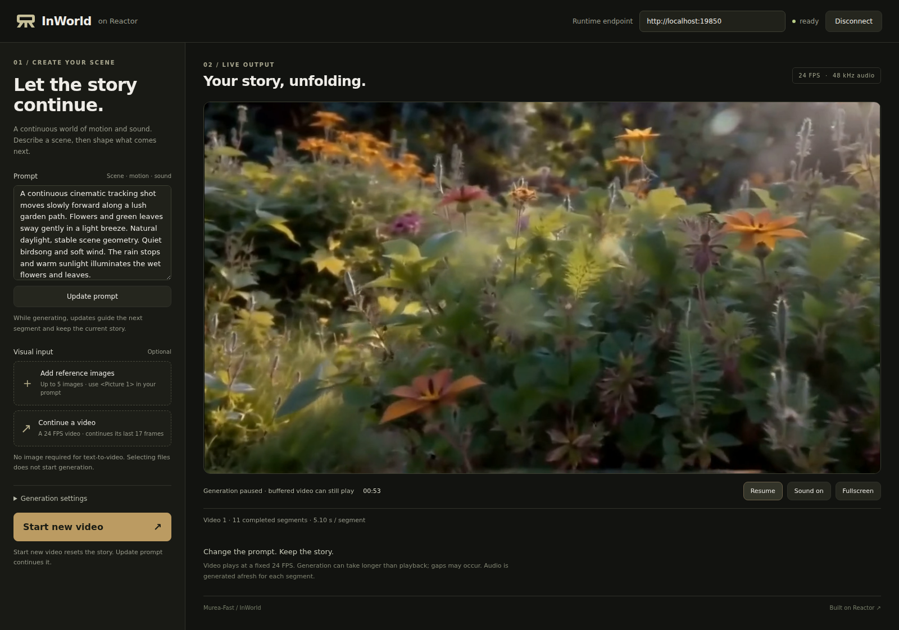

# InWorld on Reactor

Create continuous audio-video stories with [InWorld / Murea-Fast](https://github.com/Murea-Labs/InWorld), powered by [Reactor](https://reactor.inc). Describe a scene, optionally add ordered reference images or a previous video, and update the prompt as the story continues.



What this integration adds:

- **A streaming service:** run Murea-Fast with `reactor build` and `reactor run`, and receive each generated segment with its audio.
- **Interactive prompts:** change the next segment's description while retaining the previous video's visual continuation. Pause, resume, or start a fresh video explicitly.
- **A small browser demo:** text-only generation, up to five ordered references, or continuation from an uploaded video, using the official JavaScript SDK.

This integration serves Murea-Fast. The upstream Murea-Mind agent, its story-management tools and third-party language/image API calls remain available through the authors' own application.

## What you need

- Linux, four NVIDIA B200 GPUs for the default accelerated configuration, Docker and the [NVIDIA Container Toolkit](https://docs.nvidia.com/datacenter/cloud-native/container-toolkit/latest/install-guide.html). Generation is tested at 1280 × 704; other hardware has not been validated.
- Enough disk for the image and the pinned InWorld and LTX-2.5 weights. Model downloads stay outside the image.
- A Hugging Face account with access to [Lightricks/LTX-2.5-Diffusers](https://huggingface.co/Lightricks/LTX-2.5-Diffusers) and its licence accepted, plus an `HF_TOKEN` with read access.
- Node.js 22.12+ and npm for the demo.

Run the commands below from the directory containing this README and `reactor.yaml`.

## 1. Install the Reactor CLI

```sh
brew install reactor-team/tools/reactor-cli
```

For Linux without Homebrew:

```sh
ARCH=amd64
mkdir -p ~/.local/bin
curl -fsSL "https://releases.reactor.inc/reactor-cli/latest/reactor-cli_linux-${ARCH}.tar.gz" \
  | tar -xz -C ~/.local/bin
export PATH="$HOME/.local/bin:$PATH"
```

**Check:** `reactor version` prints a version. Use a current CLI with `reactor run --shm-size` support; large audio-video segments require more than Docker's default shared memory.

## 2. Build and start the model

Set `HF_TOKEN` in your shell without committing it, then:

```sh
reactor build
reactor run --gpus '"device=0,1,2,3"' --port 8080 --shm-size 4g -e HF_TOKEN
```

Select an available GPU on shared machines. Startup downloads the pinned Murea-Fast checkpoint and required LTX-2.5 components and prepares the trained text connectors. Cached downloads are reused. Use `--weights /path/to/model-cache` to choose a different storage location.

`inworld.yaml` defaults to `num_gpus: 4`, `attention_backend: fa` and `cuda_graph: true`. FA4 and CUDA Graph preserve the eight sampling steps and continuation length. FA4 has floating-point differences from SDPA. The pinned upstream LTX25 pipeline requires an explicit Graph allowlist override; this integration enables the tested path, with lazy capture for new input shapes. First use includes compilation and capture. For single-GPU use, set `num_gpus: 1` and expose one GPU; rebuild after configuration changes. Set `cuda_graph: false` and `attention_backend: torch_sdpa` for the original attention path.

**Check:** `curl -fsS http://localhost:8080/health` reports `"state":"available"`. Initial downloads and loading take time. Leave the service running; `Ctrl+C` stops it. After changing code or dependencies, rebuild before restarting. A crashed model requires a service restart, not just a browser reconnect.

## 3. Open the client

In another terminal:

```sh
cd demo
npm ci
npm run dev -- --host 127.0.0.1
```

Open the URL printed by Vite, normally **http://localhost:5173**. Set **Runtime endpoint** to `http://localhost:8080`, then click **Connect**.

1. Enter a prompt describing appearance, motion, sounds and dialogue.
2. Optionally choose up to five reference images, or one parent video. Selecting files alone does not generate anything. No image is selected by default.
3. Click **Start video**. Audio and video appear when the first segment finishes; connecting or selecting files does not start playback or its clock. If your browser blocks autoplay, click **Play with sound**. Use **Sound on / Sound off** to toggle audio.
4. Edit the text and click **Update prompt** to condition upcoming segments. **Pause** stops generating at a segment boundary; **Resume** continues the same video.

**SSH access:** forward the frontend and Runtime HTTP ports. WebRTC audio/video also requires a reachable TURN-over-TCP relay and its TCP port forwarded through SSH. HTTP forwarding alone, including Docker host networking, does not forward WebRTC UDP. Configure the Runtime's supported STUN/TURN settings for your network; credentials and machine-specific forwarding commands do not belong in the model manifest. The included demo uses local Runtime mode. Hosted deployment requires a server-side exchange for a session-scoped Reactor token.

## Inputs and controls

| Control | Effect |
| --- | --- |
| Prompt / **Update prompt** (`set_prompt`) | Describe the next segment. Use `<Picture 1>` through `<Picture 5>` to refer to ordered images. Empty prompts are refused. |
| Reference images (`set_reference`) | Stage one to five images for a fresh video; preserve their selection order. Each image is limited to 25 MiB / 20 million pixels. Upstream fitting handles the references. |
| Parent video (`set_video`) | Stage a 24 FPS video with at least 17 frames, at most 60 seconds / 256 MiB. Generation continues its last 17 frames. Images and parent video are mutually exclusive. |
| **Start new video** (`start`) | Begin from the staged inputs with the chosen seed and segment length. Replaces the current video's buffered output. |
| New frames | Default 120: 5 seconds of new video at 24 FPS. A fresh text/image video includes one extra opening frame (121 total); continuation emits 120 new frames. |
| **Pause / Resume** (`set_paused`) | Pause/resume future generation. Buffered audio/video keeps playing. Updating a paused video's prompt leaves it paused. |

The default resolution is 1280 × 704. Each call generates a complete native segment, then streams that segment while preparing the next. Prompt updates do not alter an in-flight segment or already-buffered output. Changes may be gradual; the model does not guarantee strict scene edits.

Visual continuation follows the upstream 17-frame video-prefix mechanism. Audio is generated afresh for each segment, so uninterrupted speech or music across boundaries is not guaranteed. Generation, saved history and Runtime video playback use native 24 FPS timing with stereo 48 kHz audio. The application pins video playback to 24 FPS so generation speed does not stretch the video relative to audio. Generation below real time can still cause playback gaps; fixed FPS does not guarantee uninterrupted audio/video delivery.

## Validation

Four-B200 tests generated 10 consecutive segments (1,201 new frames) per configuration. Steady model-runner throughput was **20.62 FPS** for SDPA, **22.63 FPS** for FA4 and **23.57 FPS** for FA4 with CUDA Graph. These measurements include inference and media preparation, excluding browser transport; they do not establish end-to-end 24 FPS. The adapter caches decoded continuation tails, transfers uint8 output from the GPU and converts new RGB frames in parallel while preserving native output encoding and history.

All ten four-GPU SDPA segments matched the native reference's complete decoded RGB and audio hashes. FA4 with Graph matched FA4 without Graph for all ten segments; FA4 is not pixel-identical to SDPA. The CPU tests cover both halves, refused and failed steps, uploads, anchor acknowledgement, the actual Runtime step loop, media-conversion fidelity and multi-rank pre-inference failure notification.

A four-GPU FA4/Graph `reactor run` browser session with fixed 24 FPS completed 11 segments, two prompt updates, pause/resume and reconnect through TURN/TCP. Before disconnect, the browser decoded 1,201 frames with zero reported drops and received audio; some video remained buffered. Connected-idle and reference-selection checks confirmed that playback and its clock wait for generation. Cold Graph capture delays the first segment; later segments took approximately 5.1 seconds. Runtime still inserted some silence, so this does not establish gap-free audio or perfect audio/video synchronization.

The production-built frontend also passed one-reference, two-reference and uploaded-video tests with four-GPU Graph enabled, each completing two segments with 24 new frames per segment. Three-to-five-image combinations and longer-than-default segment lengths have not been GPU-validated. Saved frames were inspected; temporal and audio quality still benefit from human review.

## More

- [Reactor SDKs](https://docs.reactor.inc/sdk-reference/using-the-sdk) and [deployment documentation](https://docs.reactor.inc/deploy).
- The running service publishes the contract at `/schema`: commands return `input_accepted` to the caller and broadcast complete `state_update` messages.
- `inworld.py` owns commands and sessions; `inworld_model.py` owns generation state; `inworld_backend.py` calls upstream inference; `inworld_assets.py` prepares assets; `inworld_types.py` declares tracks and messages; `demo/` is the client.
- The image installs one pinned official source revision. Changes to sibling upstream code are not automatically included: update the source pin and validate before rebuilding.

## Credits

Thanks to [Rising0321](https://github.com/Rising0321) for porting InWorld to Reactor. The model and original inference implementation are by the Murea-Labs team.

## Licence

Upstream InWorld code is [Apache-2.0](https://github.com/Murea-Labs/InWorld/blob/main/LICENSE); its vendored dependencies retain their own notices. Murea-Fast weights derive from LTX-2.5 and follow the [LTX-2.x Community License Agreement](https://github.com/Lightricks/LTX-2/blob/main/LICENSE-2_x). See upstream [provenance](https://github.com/Murea-Labs/InWorld/blob/main/inference/docs/provenance.md). Weights are downloaded under those terms and are not included in the image.
