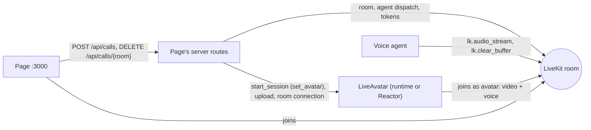

# Talk to the avatar

A page where you talk to a voice agent that speaks through LiveAvatar. Three processes, each with one job:

| Process | Folder | Does | Holds |
| --- | --- | --- | --- |
| The page and its server routes | this folder | Starts and stops each call: the room, the agent, the avatar's session; then joins the room in your browser | LiveKit's API secret; the Reactor API key when the model runs on Reactor |
| The voice agent | [`agent/`](agent) | The conversation (OpenAI Realtime), spoken through the avatar | LiveKit's API secret, the OpenAI key |
| The model | [`..`](..) | Joins the room as the avatar, lip-syncs the agent's speech | Nothing of the call's |



A call starts in this order, all in [`app/api/calls/route.ts`](app/api/calls/route.ts): create the room, dispatch
the agent and wait for it, mint the avatar's token (kind `agent`, publishing on behalf of the agent), start the
model's session with the portrait and have it join the room ([`lib/reactor.ts`](lib/reactor.ts)), and only then hand
the browser its token. Hanging up stops the session and deletes the room; if the page cannot, the agent deletes the
room when the user leaves, and the avatar leaves with it.

## What you need

- The model running: `reactor run` from the model folder (see [`../README.md`](../README.md)), or the model deployed
  on Reactor and a Reactor API key.
- A LiveKit project whose URL the model can reach (LiveKit Cloud works): its `wss://` URL, API key and secret.
- An OpenAI API key with Realtime access.
- Node.js 20+, [uv](https://docs.astral.sh/uv/), and a browser with a microphone, on `http://localhost` (browsers
  allow the microphone only there or on HTTPS; on a remote machine, `ssh -L 3000:127.0.0.1:3000 <host>`).

## 1. The voice agent

```sh
cd agent
cp .env.example .env       # LiveKit's three values, OPENAI_API_KEY, AVATAR_AGENT_NAME
uv run python agent.py dev
```

**Check:** the log says `registered worker {"agent_name": "<AVATAR_AGENT_NAME>", ...}`. The name makes the worker
join only the rooms this page dispatches it into, even on a shared LiveKit project.

## 2. The page

```sh
npm install
cp .env.example .env.local # LiveKit's three values, the same AVATAR_AGENT_NAME, and the model
npm run dev                # http://127.0.0.1:3000
```

Point the page at the model with `REACTOR_RUNTIME_URL=http://127.0.0.1:8080` for a runtime you serve, or with
`REACTOR_API_KEY` and `REACTOR_MODEL` for a model on Reactor. **Check:** `curl -s http://127.0.0.1:3000/api/status`
names the model, the LiveKit host and the agent.

## 3. Talk

Open `http://localhost:3000`, optionally pick a portrait (one face, frontal; without one the model's default
portrait), pick a voice, and press **Start call**. The agent greets you through the avatar a few seconds later.
Interrupt it by talking over it; **End call** hangs up.

## When it does not work

| Symptom | Fix |
| --- | --- |
| "the voice agent ... did not join within 20 s" | The agent is not running, or `AVATAR_AGENT_NAME` differs between `.env.local` and `agent/.env` |
| "the runtime refused the session: HTTP 409" | A runtime serves one session at a time: end the other call, or wait a few seconds after one ends |
| "the avatar could not join the room" | The model cannot reach `LIVEKIT_URL`, or the LiveKit key and secret do not match the project |
| The avatar appears but never speaks | The agent has no OpenAI Realtime session: check its log and `OPENAI_API_KEY` |
| No microphone prompt | Open the page as `http://localhost:<port>`, with port forwarding on a remote machine |
