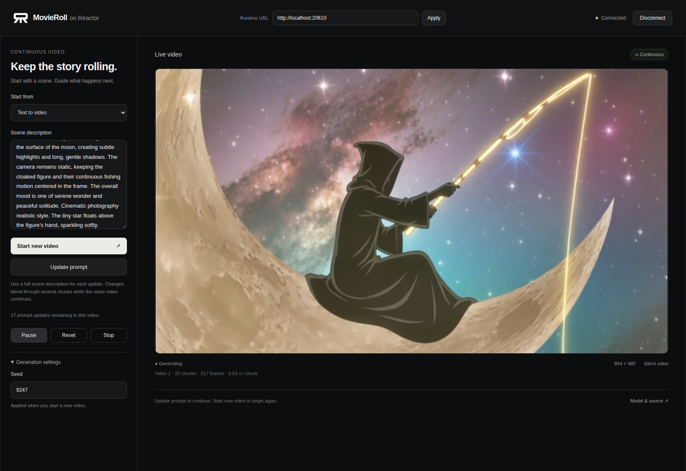

# MovieRoll on Reactor

Run [MovieRoll-Distilled](https://github.com/Tencent-Hunyuan/MovieRoll) as a
continuous text-to-video or image-to-video service with [Reactor](https://reactor.inc).
Start a scene, watch it unfold, and update its description while the same video continues.



The service uses the released five-step T2V and I2V checkpoints. Both checkpoints,
the text encoders and VAE stay resident on each GPU. Generation continues until
Pause, Stop, session end, or the configured temporary-storage limit. Playback
adapts to generation speed.

## What you need

- Linux, Docker, an NVIDIA driver and the
  [NVIDIA Container Toolkit](https://docs.nvidia.com/datacenter/cloud-native/container-toolkit/latest/install-guide.html).
- Four NVIDIA B200s with NVLink for the default sequence parallel deployment.
  A single-B200 local run is also supported.
  Other GPU architectures, quantization and offload have not been validated here.
- About 85 GB for inference weights, plus the Docker image, build cache and
  writable temporary video history.
- Access to the [MovieRoll weights](https://huggingface.co/yunyangge/MovieRoll):
  accept their usage terms with your Hugging Face account.
- Node.js 22.12+ and npm for the frontend.

Run backend commands from this directory.

## 1. Install the CLI

```sh
brew install reactor-team/tools/reactor-cli
reactor version
```

For Linux without Homebrew, follow the
[CLI installation guide](https://docs.reactor.inc/deploy/platform/installation).
This recipe uses Runtime 3.11.7, Python 3.12, CUDA 12.8.1 and FlashAttention 4
on Blackwell. The manifest builds its dependencies and one pinned copy of the
native source; no changes to native inference files are required.

## 2. Build and start the model

Make an authorized Hugging Face read token available as `HF_TOKEN` in your shell,
then run:

```sh
reactor validate
reactor build
reactor run --gpus '"device=0,1,2,3"' --port 8080 --shm-size 4g -e HF_TOKEN
```

`-e HF_TOKEN` forwards the existing environment value. Keep its value outside
source files and the manifest. First startup downloads only the two distilled
checkpoints and their shared VAE, Qwen, ByT5 and Glyph assets. Base-model and
training checkpoints are unnecessary.

Weights default to `~/.cache/reactor_registry/movieroll`; use
`--weights /path/to/movieroll` for another volume. A fully prepared cache is
reusable without downloads or writes, including with a read-only weights mount.
The source and asset revisions are recorded in `movieroll_assets.py`.

The selected host devices are presented to the workers as GPUs 0–3. Select
available GPUs on a shared machine. Rebuild after changing code, dependencies
or YAML. The manifest requests four B200s and `movieroll.yaml` starts four
Runtime workers, using the native sequence-parallel transformer and parallel
VAE decoder. Both checkpoints and the shared encoders stay resident on every GPU.

For a single-GPU local run:

```sh
reactor run --gpus device=0 --port 8080 --shm-size 4g \
  -e MOVIEROLL_GPU_COUNT=1 -e HF_TOKEN
```

`gpu_count` accepts 1 or 4; `MOVIEROLL_GPU_COUNT` overrides it for local runs.
For a single-GPU platform deployment, set both `model.resources.gpu.count` in
`reactor.yaml` and `gpu_count` in `movieroll.yaml` to 1.

In another terminal, wait for readiness:

```sh
curl -s http://localhost:8080/health
curl -s http://localhost:8080/schema
```

Wait for `"state":"available"`. Weight loading precedes readiness; the first
video also pays for text encoding, attention compilation and rolling-window
prefill. `Ctrl+C` stops the backend. An unexpected inference failure ends the
service; restart it before reconnecting.

## 3. Open the client

In another terminal, from this directory:

```sh
cd demo
npm ci
npm run dev -- --host 127.0.0.1 --port 5173
```

Open [http://localhost:5173](http://localhost:5173). In the center of the top bar,
set **Runtime URL** to `http://localhost:8080`, click **Apply**, then **Connect**.
Connecting alone generates no video.

Choose **Text to video**, enter a full scene in **Scene description**, and press
**Start video**. For **Image to video**, upload a PNG, JPEG or WebP first, then
press **Start video**. There is no default image. Uploading or changing the
selection prepares the next Start; it does not replace the running video.

The silent video is 864 × 480. Check that the chunk and frame counts increase.
To test the production build instead:

```sh
npm run build
npm run preview -- --host 127.0.0.1 --port 5173
```

If the browser runs on another machine, it must reach both HTTP and WebRTC.
For SSH-only access, configure an authenticated TURN-over-TCP relay through the
Runtime's supported `TURN_SERVERS` setting and forward its TCP listener as well
as the frontend and Runtime ports. Forwarding HTTP alone does not carry video.
Relay addresses must also be reachable from the serving container. Keep relay
credentials in deployment configuration, outside this repository.

## Controls

| Client control | SDK command | Behavior |
| --- | --- | --- |
| Start video / Start new video | `start(prompt, seed, mode)` | Start a fresh video with the selected T2V or I2V checkpoint. |
| Initial image / Remove image | `set_image(image)` / `clear_image()` | Stage or clear the next starting image. |
| Update prompt | `set_prompt(prompt)` | Change the description while retaining the current video and pause state. |
| Pause / Resume | `set_paused(paused)` | Hold or resume future generation; buffered frames may still play. |
| Reset | `reset(seed?)` | Restart with the current caption and original starting image; retain the seed unless supplied. The UI retains it. |
| Stop | `stop()` | End this video, clear playback and remove temporary history; keep the staged image and caption. |
| Disconnect | SDK `disconnect()` | End the shared session and clear its local identity and progress. |

Use **plain text**, one full scene caption per update. JSON and timestamps are
unnecessary. MovieRoll blends new captions through its rolling window: frames
already generated keep their earlier caption, and a new action can take several
chunks to appear. Update prompt preserves history; Start new video and Reset
begin again. Changing Seed affects the next Start. Connect waits briefly if the
previous session is still closing.

Images are limited to 20 MiB and 32 million pixels, are rotated upright,
resized with the native LANCZOS filter, and center-cropped to fit. Animated
images and extreme aspect ratios that require an oversized resize are refused.
A refused command preserves the previously accepted image, prompt and pause state.

Each video accepts up to 20 captions including its starting caption; unchanged
captions do not consume another slot. The client shows the remaining updates.
Start a new video after that limit. Duration is independent of this caption
limit. The default temporary history budget is 16 GiB per video per GPU worker, configured by
`history_gib` in `movieroll.yaml`. A full archive ends the video with
`end_reason: "history_full"`; Start begins another one. History is removed on
Stop, Reset and session teardown. Put `session_path` on a writable data volume
for long sessions, separately from weights; `MOVIEROLL_SESSION_PATH` can override
it at deployment.

## Validation and limits

The default four-B200 NVLink configuration uses the native five sampling steps,
BF16 transformer, resident checkpoints/encoders, and original history policy.
Measurements use the canonical Reactor image and 864 × 480 output:

| Check | Measured result |
| --- | --- |
| Worker, T2V | 25.85 FPS over chunks 2–20; 22.01 FPS over chunks 61–100 of one continuous 100-chunk / 1,597-frame video. |
| Worker, I2V | 25.89 FPS over chunks 2–20. |
| Initial wait | First 13 frames in 12.57 s for T2V and 12.83 s for I2V, excluding weight loading. The complete 100-chunk T2V run averaged 20.00 FPS including its initial wait. |
| Official native controls | T2V and I2V, 20 chunks each: all 81 latent frames and the first 317 RGB frames exactly equal to the official four-GPU launcher, before video encoding. |
| Dynamic captions | The official six-event script, T2V and I2V, 20 chunks each: latents/RGB exactly equal to the unoptimized four-GPU Reactor control; latents also exactly equal to the official single-GPU control. |
| Long numerical control | All 401 generated latent frames in the 100-chunk T2V run exactly equal to the unoptimized four-GPU Reactor control. All four ranks retained identical latent bytes. |
| Production browser | 100 continuous T2V chunks with two live caption edits; 22.88 published FPS and 22.87 presented FPS over the uninterrupted chunks 20–100 interval. I2V live edits, pause/shared viewing, Reset, Stop and fresh-session reconnect passed. |
| Browser transport | Relay-only TURN/TCP, 864 × 480, 1,614 decoded frames and 0 reported drops at sampling. Warm-service video element ready 1.71 s after Start. The buffered tail was not fully drained before switching videos. |
| Single-B200 local path | 9.40 worker FPS over chunks 2–20; 81 latent / 317 RGB frames exactly equal to the official single-GPU T2V control. |
| Checks | 53 CPU tests, an optional GPU test covering 64 fused-kernel cases, unchanged eight-command schemas, manifest validation, canonical image build and production frontend build passed. A minimal environment without Torch passes 47 hook/model tests and skips the numerical tests. |

Worker rates include sampling, decoding and IPC, before WebRTC encoding. Browser
rates above measure the same continuous interval without the earlier pause/join
check; presentation across the complete browser run, including that pause, was
21.98 FPS. Sustained generation remains below 24 FPS.
The long runs crossed the native decoder's 361-latent history boundary without
resetting the world.

Inference optimizations reuse integer attention metadata and exact native
timestep projections, avoid redundant text-shape exchanges and contiguous KV
copies, convert RGB on the GPU before transfer, and fuse broadcast modulation
and gating. The Triton kernel retains native intermediate rounding and disables
FMA fusion. Numerical comparisons apply to the tested inputs and devices;
browser/video encoding is lossy.

Fixed-seed native comparisons use the official launcher without Reactor Runtime
and the same B200/FA4 compatibility path as the service. The original launcher
imports an FA3 interface; this recipe explicitly supplies FA4 on Blackwell.
These comparisons do not establish equality to an FA3 run on Hopper. Across
native one- and four-GPU controls, latents match exactly; parallel VAE decoding
changes about 0.43% of RGB channels by one 8-bit level.

The first published chunk has 13 frames, followed by 16 frames per chunk. Four
frames remain pending to preserve the original four-latent decoding groups;
they arrive with the next chunk. Stop discards pending output. The native
exporter labels saved video at 24 FPS; streaming playback adapts to generation.

Long-form output can drift. The released decoder uses its original bounded
attention history after 361 latent frames. This integration preserves that policy;
it does not promise indefinite visual consistency or unlimited caption changes.

## API and implementation

The demo uses the official [JavaScript SDK](https://docs.reactor.inc/using-the-sdk)
in local mode. `GET /schema` describes the commands, their refusal codes and the
`state_update` message. Each accepted change replies with a full state snapshot
and broadcasts it to viewers; a joining snapshot goes only to its caller.
The SDK-only `get_state()` command reads that snapshot without modifying or
broadcasting state. The client requests it once after connecting: SDK 3.4.0 with
Runtime 3.11.7 can miss the initial push when joining an already-paused session.
Hosted use additionally requires platform deployment and a backend session-token
exchange.

`movieroll_app.py` owns commands and client state. `movieroll_model.py` and
`movieroll_backend.py` own weights and native rolling inference behind a
`DistributedRunner` worker. `movieroll_history.py` preserves the original latent
bytes for historical reads without accumulating a video-long GPU tensor list.
The model half imports no Runtime code.

CPU hook/model tests run without native model dependencies or a GPU:

```sh
python -m pip install reactor-runtime==3.11.7 pytest 'Pillow>=12.1.1'
PYTHONPATH=. python -m pytest tests/ -q
python -m reactor_runtime.schema --path . --out /tmp/movieroll-schema.json
```

## Credits and license

MovieRoll and its checkpoints are by the [MovieRoll authors](https://github.com/Tencent-Hunyuan/MovieRoll).
Their source, weights and shared assets retain their respective upstream licenses
and usage terms; see the upstream [LICENSE](https://github.com/Tencent-Hunyuan/MovieRoll/blob/main/LICENSE)
and [NOTICE](https://github.com/Tencent-Hunyuan/MovieRoll/blob/main/NOTICE).
The Reactor integration is by [Rising0321](https://github.com/Rising0321).

Feedback on the integration and collaboration with Reactor are welcome at
[ruixing@reactor.inc](mailto:ruixing@reactor.inc).
