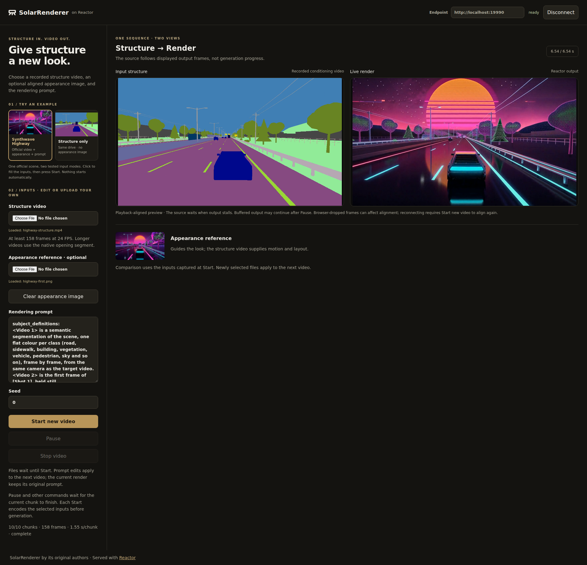

# SolarRenderer on Reactor

Render a recorded structure video with [SolarRenderer](https://github.com/Enderfga/SolarRenderer),
served through [Reactor Runtime](https://github.com/reactor-team/reactor-runtime).
Select a structure video, optionally supply an aligned appearance image, describe the scene,
and receive the rendered video in a small browser demo.



**Validation status:** this four-B200 integration is a development preview.
The browser has completed ten chunks (158 frames) with and without
an appearance reference, including a forced TURN/TCP media path.
Observed steady chunks take about 2 seconds for 17 frames. With resident weights,
input encoding and the first chunk took 31–33 seconds in the two tested modes. This is below the native 24 FPS timeline.
FA4 and static-prefix caching change
floating-point results; the accelerated version is not bitwise identical to native inference.

## What the integration adds

- A Reactor service with explicit input selection, Start, Stop, Pause and Resume.
- Streaming output as completed video segments become available.
- A browser client using the official Reactor JavaScript SDK.
- Four-GPU sequence parallelism, FA4, modulation/text/static-prefix caching and parallel VAE decoding.
- Clickable example inputs and a side-by-side structure/render view.

The service uses the released causal four-step model. Each video contains 158 frames
and ends after ten chunks. Its native timeline is 24 FPS (about 6.58 seconds).
Runtime adapts playback to generation time. The measured generation rate
is substantially below the native 24 FPS timeline.

## What you need

- A license and deployment location permitted by the model's weight terms.
- A Linux GPU machine with Docker and NVIDIA Container Toolkit. The recipe was
  tested on four B200 GPUs on one host, with shared read-only weights and writable temporary storage.
- The prepared MiniMax-H3 base and the two **causal** SolarRenderer LoRA files.
- Node.js 22.12+ and npm for the demo.

## 1. Install the Reactor CLI

Install the CLI using the [Reactor documentation](https://docs.reactor.inc/deploy).
Use a current CLI that supports `reactor run --shm-size`; older releases forward
unknown flags to Runtime. Check `reactor version` and `reactor run --help`.
Run the following commands from this directory.

## 2. Get the weights

Read the [weight license](https://huggingface.co/Enderfga/SolarRenderer/blob/main/LICENSE)
before downloading. Follow the authors' [setup and causal inference instructions](https://github.com/Enderfga/SolarRenderer/blob/main/docs/inference.md).
Use their `scripts/prepare_h3.py` to prepare the base and localize its component index.
Arrange the files under one directory:

```text
weights/
  MiniMax-H3/
    modular_model_index.json
    transformer_ref/
    text_encoder/
    processor/
    tokenizer/
    vae/
    ...
  solarrenderer_causal_control_lora.safetensors
  solarrenderer_causal_4step_lora.safetensors
```

Keep the prepared base at the same absolute path when mounting it into the container:
the localized component index refers to that path. The CLI's filesystem `--weights`
mount does this. The service does not automatically download or substitute checkpoints.

## 3. Start the model

```sh
reactor build
reactor run --gpus device=0,1,2,3 --shm-size 8g --port 8080 --weights ./weights
```

Select four available GPUs on a shared machine. In another terminal, check
`curl http://localhost:8080/health`. The service loads the encoder and renderer once at startup. Wait until health reports
`available` before connecting. Both stay resident across videos; each Start encodes
its selected inputs and prepares a fresh video. Scratch files use the container's
temporary directory, separate from the read-only checkpoint mount.

The manifest builds from YAML; no Dockerfile is needed. Rebuild after changing the
adapter. `Ctrl+C` stops the service started by this command.

## 4. Open the client

```sh
cd demo
npm ci
npm run dev -- --host 127.0.0.1
```

Vite reuses `examples/sem-highway_synthwave/` from a sibling `SolarRenderer` or
`source` checkout when available. Otherwise, it automatically downloads the three
official sample files from upstream revision `a2371eaecff9a8ab378b5ec36199c5863d138074`
into `demo/node_modules/.cache/solarrenderer/` on the first run and verifies their
SHA-256 checksums. No sample path configuration is needed. Production builds include
the samples and can be served independently.

Open http://localhost:5173. The default Runtime address is http://localhost:8080;
set `VITE_RUNTIME_URL` before starting the demo to use another local endpoint.
Click **Connect**, choose **Synthwave Highway** to fill the official video, image
and prompt, then click **Start new video**. **Structure only** uses the same scene
without an appearance image and adjusts the prompt accordingly. You can also upload
your own inputs. File or example selection alone
does not run the model. No example or reference image is selected automatically.

The authors provide a matched [structure video, image and prompt](https://github.com/Enderfga/SolarRenderer/tree/main/examples/sem-highway_synthwave).
Use that complete set for the first comparison. Structure videos must cover at least
158 frames after native 24 FPS resampling; longer videos use the opening segment.
Landscape input produces 1344×768 output and portrait input 768×1344. The original
preprocessing center-fits the optional image to the selected canvas.

### Remote machines and SSH

Forward the HTTP and demo ports if running both on a remote machine:

```sh
ssh -L 8080:127.0.0.1:8080 -L 5173:127.0.0.1:5173 user@gpu-host
```

HTTP forwarding alone does not carry WebRTC media. Configure a supported TURN-over-TCP
relay and forward its TCP port as well, or use a network route that carries WebRTC.
Docker host networking alone does not make SSH forward UDP. Keep relay credentials
in deployment configuration; never put them in this repository. SSH/TURN media
connectivity has been exercised in a relay-only local browser. Validate your own
SSH tunnel and relay configuration before sharing the service.

## Controls

| Control | Effect |
| --- | --- |
| Structure video | Select the recorded motion and layout for the next video. |
| Appearance reference | Optionally constrain the opening appearance. |
| Rendering prompt / Seed | Captured when Start is pressed. |
| Start new video | Start a fresh finite video, replacing any current render. |
| Pause / Resume | Stop or continue at a generation boundary; buffered video may still play. |
| Stop video | End the current video, reset generation and clear buffered playback; keep selected inputs. |
| Disconnect | End the shared session through the SDK. |

Commands take effect after the current chunk. Pause/Resume requires an active
video and returns `not_running` otherwise. The demo waits up to 180 seconds for
commands that include input preparation. `set_structure`, `set_image`,
`clear_image`, `set_prompt` and `set_seed` stage the next Start. `state_update`
reports `completed_chunks`, `output_frames` and `last_chunk_seconds`.

Prompt edits apply to the **next video**. This first integration preserves the original
fixed text conditioning throughout each render; it does not advertise live prompt changes.
There are no driving keys or game-engine controls: motion is supplied by the uploaded video.
The decoder waits for the necessary temporal overlap before showing its first frames.

## Validation and code map

Run CPU application tests with `PYTHONPATH=. python -m pytest tests/ -q` and export
the client contract with `python -m reactor_runtime.schema --path . --out schema.json`.
`reactor validate` checks the manifest; `npm run build` in `demo/` checks the frontend.

`solarrenderer.py` owns client commands and output, `solarrenderer_types.py` defines
the public state, and `solarrenderer_model.py` owns the Runtime-independent step contract.
The backend reuses the pinned native encoder and LoRA loader. Sampling and decoder
helpers retain per-video state between calls. The build uses upstream revision
`a2371eaecff9a8ab378b5ec36199c5863d138074` and Reactor Runtime 3.10.0. The YAML-built image has completed both input modes on four B200s
with the checkpoint directory mounted read-only.

CPU tests exercise both halves, replaced-world results, Stop/reset, command
refusals, joining-viewer snapshots, upload validation and loading weights once
across repeated starts. Four denoising evaluations, the native history window
and the finite horizon are preserved. FA4 and static-prefix reuse change
floating-point results, so the four-GPU path has no bitwise-parity guarantee.

The native encoder re-reads the validated uploads. Both appearance-reference
and structure-only modes have completed ten-chunk / 158-frame browser runs;
input encoding and first-use kernel compilation are separate from steady chunk
timing. Detailed benchmark artifacts are kept outside the recipe.

## Credits and licence

Thanks to [Rising0321](https://github.com/Rising0321) for the Reactor integration.
SolarRenderer and SolarWM remain the work of their original authors. The sampling and
decoder helpers derive from SolarRenderer's Apache-2.0 code; retain its attribution and
[NOTICE](https://github.com/Enderfga/SolarRenderer/blob/main/NOTICE).
Weights remain subject to the MiniMax H3 Community License, including territorial
restrictions. Please contact [ruixing@reactor.inc](mailto:ruixing@reactor.inc) with integration
feedback or collaboration ideas.
